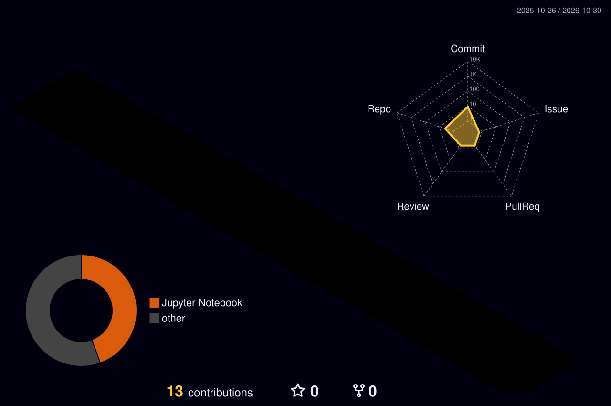

<p align="center">
  
</p>

<p align="center">
  
</p>

<p align="center">
  
  
  
</p>

<br/>

<!-- ====================== 3D CONTRIBUTIONS ====================== -->
<p align="center">
  
</p>

<br/>

## `> whoami`

<table>
<tr>
<td width="55%" valign="top">

```yaml
name:      Tal Berger
role:      CS Student & Developer
location:  Israel 🇮🇱
passions:
  - 🎮 Game engines & graphics (OpenGL / LWJGL)
  - 🧠 Machine Learning
  - ⚙️ Systems & low-level programming
currently: Building a 3D engine in Java
motto:     "Ship it, then make it pretty."
```

</td>
<td width="45%" valign="top" align="center">


</td>
</tr>
</table>

## `> ls ./tech-stack`

<p align="center">
  <br/>
  <br/>
  
</p>

## `> ls ./projects`

### 🎮 Game Development

<table>
<tr>
<td width="50%" valign="top">

#### 🧊 LWJGL Engine
A custom 3D game engine written from scratch in Java with **LWJGL + OpenGL** — rendering pipeline, shaders, camera & input.

  

</td>
<td width="50%" valign="top">

#### 👻 PacMan
A Pac-Man style game with ghost AI, maze logic and classic arcade gameplay.

 

</td>
</tr>
<tr>
<td width="50%" valign="top">

#### 🏃 Side Scroller
A fun side-scrolling game coded in **just 1.5 hours** — a speed-build challenge.

 

</td>
<td width="50%" valign="top">

#### 🗺️ 2D Game
A 2D game prototype — sprites, tile maps, collisions and game loop.

 

</td>
</tr>
</table>

### 🧠 Machine Learning

<p align="center">
  <a href="https://github.com/talberger12/Machine_Leaning_Targil3_Code_Exercise"></a>
  <a href="https://github.com/talberger12/Machine_Leaning_Targil4"></a>
</p>

### 🎓 Academic Work

<p>
  
  
  
</p>

## `> git log --stats`

<p align="center">
  
  
</p>

<!-- ====================== SNAKE ====================== -->
<p align="center">
  <a href="https://talberger12.github.io/talberger12/">
    
  </a>
</p>

<p align="center">
  <a href="https://talberger12.github.io/talberger12/">
    
  </a>
</p>

<p align="center">
  
</p>
